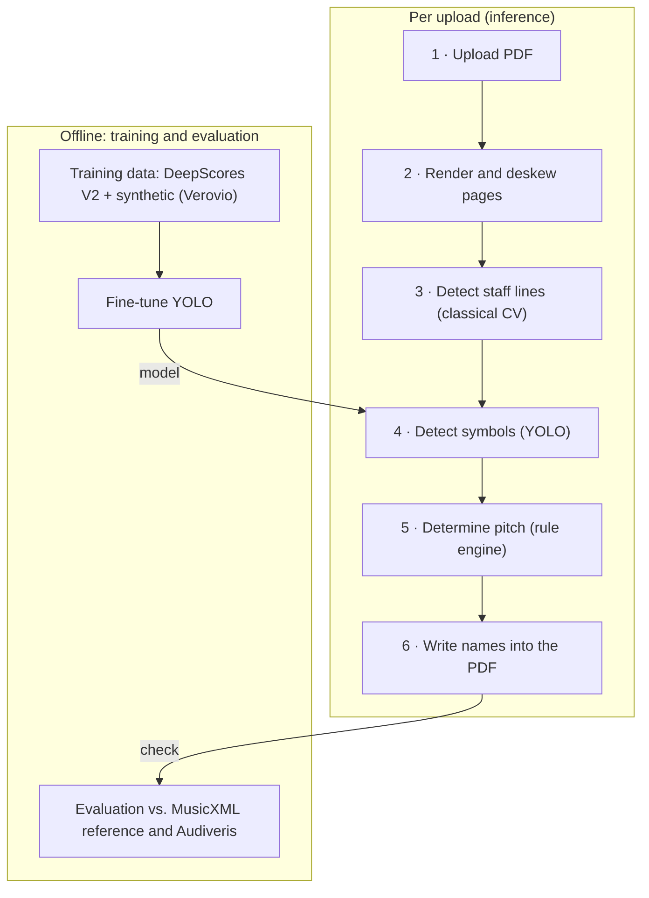

# notenamer


Automatically writes note names into piano sheet music PDFs – cleanly typeset, right in the original layout.

> **Status:** in development (phase 0 · setup & baseline). Results will follow after phases 3 and 4.

## Problem

Anyone who can't sight-read fluently ends up writing note names above and below the notes by hand. For dense pieces like Chopin's Prelude Op. 28 No. 4 this takes hours, becomes unreadable and contains mistakes that you then practise wrong.

Existing OMR tools (Audiveris, PlayScore, Soundslice) produce MusicXML, MIDI or a lit-up keyboard – but no annotated original. General-purpose LLMs are unreliable at reading music notation.

**NoteNamer** takes any printed piece of sheet music and returns *the same* PDF with the correct note name next to every note. Both German (C D E F G A H, Fis) and English (C D E F G A B, F#) note names are supported.

## Approach

The pipeline separates what has to be learned (detecting symbols) from what follows fixed rules (pitch, writing text into the PDF). That way every error can be attributed clearly to either the model or the logic.



Version 1 only needs **pitch** – no rhythm. That makes the problem much smaller than full OMR without losing the ML core.

## Quickstart

Requires [uv](https://docs.astral.sh/uv/).

```bash
uv sync
uv run pytest
uv run ruff check .
```

Conventions: all text files are UTF-8 with CRLF line endings (set in `.gitattributes` and `.editorconfig`).

## Roadmap

| Phase | Content | Gate |
| --- | --- | --- |
| 0 · Setup & baseline | Environment, test corpus, reference data, Audiveris baseline | Baseline number is known |
| 1 · Music logic | `pitch_at()`, key signatures and accidentals, German/English naming | All rule tests green |
| 2 · Staff lines | Render, deskew, find staves and grand staves | Staff lines correct on all test pages |
| 3 · Data + model | Synthetic data, DeepScores, YOLO training | Noteheads detected reliably |
| 4 · End-to-end | Pipeline, layout, evaluation against baseline | Accuracy target met |
| 5 · Release | Gradio + FastAPI, Docker, Hugging Face Space | Public demo link |

Details: [docs/concept.md](docs/concept.md) · Tasks: issues and milestones of this repo, numbered in order (0.1, 0.2, …).

## Results

*Will follow after phases 3 and 4: accuracy, comparison with Audiveris, error analysis, runtime.*

## License

[AGPL-3.0](LICENSE). The project uses AGPL-licensed libraries (PyMuPDF, Ultralytics YOLO).
