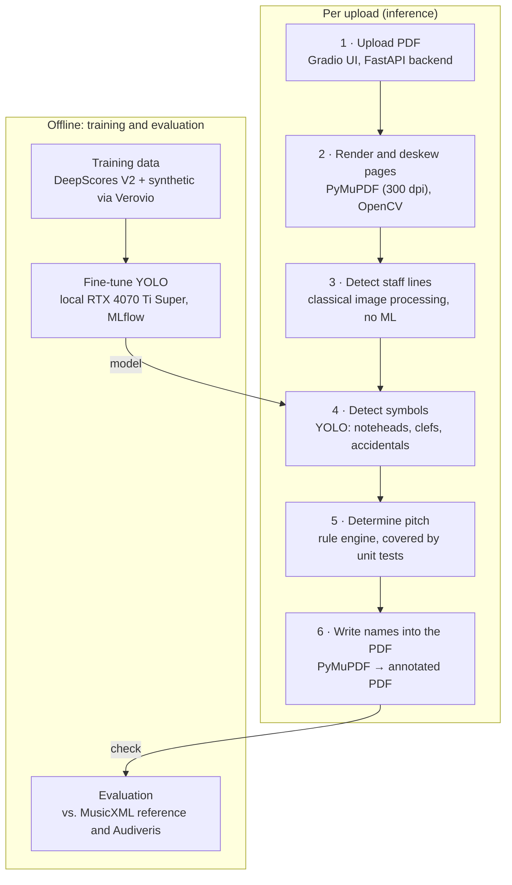
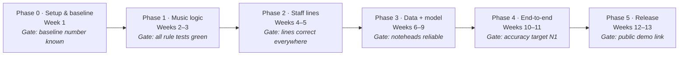

# NoteNamer – Project concept

## Background & case

NoteNamer is a web tool that automatically writes clean note names into an uploaded piano score – directly into the original PDF.

**Problem:** anyone who can't sight-read fluently writes note names above and below the notes by hand. For a piece like Chopin's Prelude Op. 28 No. 4 (dense chords in the bass) this takes hours, quickly becomes unreadable and contains mistakes that are then practised wrong.

**Existing solutions and their gap:**

| Approach | What it delivers | Why it does not solve the problem |
| --- | --- | --- |
| OMR tools (Audiveris, PlayScore 2, ScanScore, Soundslice) | MusicXML, MIDI, playback, lit-up keyboard | No annotated original; you work in a different representation than your own score |
| MuseScore + "Note Names" plugin | Note names in a newly engraved score | Only works if the piece already exists digitally; not for your own PDFs or photos |
| General-purpose LLMs (Claude, Gemini, ChatGPT) | Note names from an image | Unreliable with staff geometry, clefs and accidentals |

**Gap:** there is no tool that takes any score and returns it *in its own layout* with correct note names. That is exactly what you need for practising.

## Goal & scope

Version 1 detects the **pitch** of every note in printed piano music and writes its name into the original PDF – nothing more.

The key simplification: note names need **no rhythm**. Note durations, rests, ties, repeats and time signatures don't matter for v1. That makes the problem many times smaller than full OMR without losing the ML core.

**In v1:** printed music (PDF or clean scan), treble and bass clef, key signatures, accidentals, ledger lines, chords.

**Deliberately not in v1:** handwritten music, rhythm, fingering, audio, octave signs (8va).

## Requirements

Prioritized with MoSCoW: the Must requirements define the MVP, everything else comes later.

### Functional

| ID | Requirement | Priority |
| --- | --- | --- |
| F1 | Upload a PDF (multiple pages) | Must |
| F2 | Detect noteheads, clefs, key signatures, accidentals | Must |
| F3 | Determine the pitch of every note correctly, including accidentals until the barline | Must |
| F4 | Download the annotated PDF in the original layout | Must |
| F5 | Choose naming: German (H, Fis) or English (B, F#) | Must |
| F6 | Chord names stacked readably, without overlapping notes | Should |
| F7 | Mark uncertain detections in colour (confidence) | Should |
| F8 | Handle photos and skewed scans | Should |
| F9 | Correct note names in the browser | Could |
| F10 | MusicXML export | Could |
| F11 | Octave indication (e.g. c', C4) | Could |

### Non-functional

| ID | Requirement | Target |
| --- | --- | --- |
| N1 | Accuracy of note names on printed music | ≥ 95 % correctly named notes (test set) |
| N2 | Runtime | < 30 s per page on CPU |
| N3 | Reproducibility | One command starts the app locally (Docker) |
| N4 | Privacy | Uploads are deleted after processing |
| N5 | Code quality | Music logic fully covered by unit tests, CI green |

The targets are starting assumptions; after the first baseline measurement (phase 0) they are adjusted realistically.

## Architecture & approach

The pipeline separates what has to be learned (detecting symbols) from what follows fixed rules (pitch, writing text into the PDF).

This separation is the core of the design: every error can be attributed clearly to the model or the logic, and the logic is fully testable with unit tests. Staff lines are detected with classical methods on purpose, because they are geometrically simple and this saves training effort.

## Tech stack

The stack is deliberately lean: everything in Python, one tool per job, free to use.

| Area | Tool | Why this one | License / cost |
| --- | --- | --- | --- |
| Language & environment | Python 3.12, uv | uv manages packages and virtual environments quickly and reproducibly | PSF / MIT – free |
| Reading & writing PDFs | PyMuPDF | One library for both directions: render pages as images and write text back into the PDF | AGPL-3.0 – free for open source |
| Image processing | OpenCV, NumPy | Binarization, deskewing, staff line detection | Apache 2.0 / BSD – free |
| Object detection | PyTorch + Ultralytics YOLO | Pretrained models, fine-tuning in a few lines of code | BSD / AGPL-3.0 – free for open source |
| Training data (real) | DeepScores V2 | Large dataset with annotated music symbols as bounding boxes | CC BY 4.0 – free, attribution required |
| Training data (synthetic) | Verovio + music21 | Renders MusicXML to SVG with exact note positions → labels for free | LGPL-3.0 / BSD – free |
| Labelling own photos | Label Studio | For a small test set of real, photographed scores | Apache 2.0 (Community Edition) – free |
| Experiment tracking | MLflow (local) | Every training run traceable with parameters and metrics | Apache 2.0 – free |
| Training hardware | Own RTX 4070 Ti Super (16 GB VRAM); Colab or Kaggle as backup | 16 GB VRAM is enough for YOLO fine-tuning even at high resolution; no session timeouts | available; Colab/Kaggle free with quota |
| Backend | FastAPI | Standard for ML APIs, automatic API docs | MIT – free |
| Frontend (MVP) | Gradio | UI in a few lines, directly deployable | Apache 2.0 – free |
| Quality | pytest, ruff, GitHub Actions | Tests and linting on every push | MIT – free; Actions free for public repos |
| Packaging & deployment | Docker, Hugging Face Spaces | Live demo via link | Docker free for personal use and education; Spaces free on CPU, sleeps when idle |
| Baseline | Audiveris | Existing OMR engine as a comparison for our results | AGPL-3.0 – free |

**License note:** PyMuPDF, Ultralytics YOLO and Audiveris are AGPL-3.0. For a public GitHub repo this is no problem; our own code must then be open as well. For commercial closed-source use: buy a license or replace them, e.g. with pypdfium2 and RT-DETR via Hugging Face Transformers.

**Deliberately left out:** React, Celery/Redis, Kubernetes, a database. For an MVP with one user they only add complexity. If Gradio reaches its limits, a custom frontend can sit on top of the FastAPI later.

## Skills

Python and the basics from university are enough to start; the rest is learned in the project, phase by phase.

| Skill | Used for | Learned in phase |
| --- | --- | --- |
| Python, Git, testing | Whole project | existing, deepened |
| Music theory: clefs, key signatures, accidentals | Pitch rules | 1 |
| Classical image processing (OpenCV) | Finding staff lines, deskewing | 2 |
| Data formats & synthetic data (MusicXML, SVG, YOLO format) | Generating training data | 3 |
| Object detection & fine-tuning (PyTorch, YOLO) | Detecting music symbols | 3 |
| Evaluation (mAP, accuracy, error analysis) | Measuring and improving quality | 3–4 |
| API & deployment (FastAPI, Docker) | Making the tool usable | 5 |

## Evaluation

Measurement happens on three levels, and every number is compared against the Audiveris baseline.

**Test data:** public-domain piano pieces with MusicXML available (e.g. from OpenScore or MuseScore). The MusicXML provides the correct pitches as reference. In addition, 10–20 self-photographed pages, labelled by hand, measure the gap between clean PDFs and real photos.

| Level | Metric | Question it answers |
| --- | --- | --- |
| Symbol detection | mAP@0.5 per class | Does the model find noteheads, clefs, accidentals? |
| Pitch | Share of correctly named notes | Is the name right when the note was found? |
| End-to-end | Errors per page, split by PDF and photo | How much does a human still have to correct? |

Important for the README: not just the number, but an **error analysis** (e.g. "70 % of errors are missed accidentals in dense chords").

## Phases

About 13 weeks to the live demo at roughly 8–10 hours per week alongside university – an assumption that is reviewed after phase 1.

Every phase ends with a gate; only when it is met does the next one start. The music logic comes before the ML on purpose: it is testable without a model and later provides the reference for evaluation. After phase 5, optional: robust photo handling, correction UI, later a practice coach with audio.

The concrete tasks are issues in this repo, numbered in order (0.1, 0.2, …) and grouped by milestone (one per phase).

## Risks & open questions

The biggest risk is the gap between synthetic training data and real photos; it is measured early instead of discovered at the end.

| Risk | Impact | Mitigation |
| --- | --- | --- |
| Model only learns "clean" synthetic music | Poor results on photos | Augmentation (blur, skew, shadows), measure early on a real test set |
| Dense chords, touching noteheads | Missed or duplicate notes | Own error category in the analysis, higher resolution if needed |
| Clef change in the middle of a staff | Whole passage named wrong | Rule engine tracks the clef per position, not just per line |
| Scope too large | Project never finishes | Strict v1 scope; photos and correction UI only after the MVP |
| Copyright of sheet music | Demo not publicly usable | Live demo only with public-domain pieces |

**Open:** note names above or below the staff? For chords all notes, or only bass and top voice? Best tested in real practice sessions.
