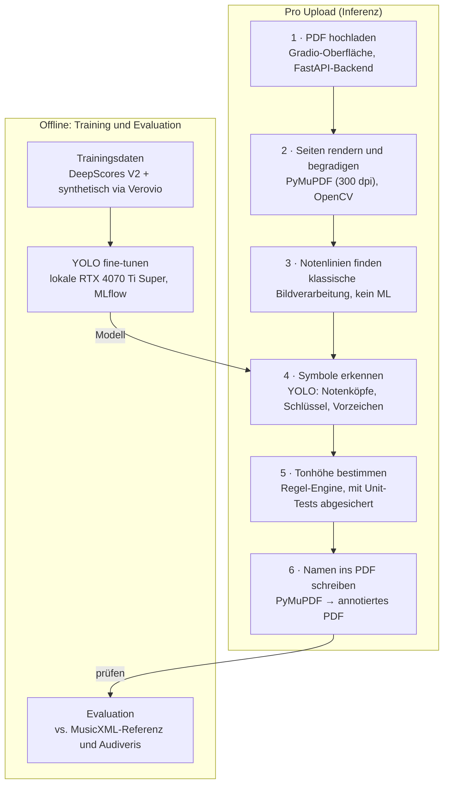
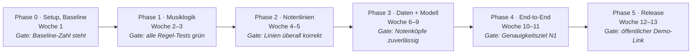

# NoteNamer – Projektkonzept

## Ausgangslage & Case

NoteNamer (Arbeitstitel) ist ein Web-Tool, das in ein hochgeladenes Klavier-Notenblatt automatisch saubere Notennamen schreibt – direkt ins Original-PDF.

**Problem:** Wer nicht flüssig vom Blatt liest, schreibt Notennamen von Hand über und unter die Noten. Bei einem Stück wie Chopins Prelude Op. 28 Nr. 4 (dichte Akkorde im Bass) dauert das Stunden, wird schnell unleserlich und enthält Fehler, die man sich dann falsch einübt.

**Bestehende Lösungen und ihre Lücke:**

| Ansatz | Was es liefert | Warum es das Problem nicht löst |
| --- | --- | --- |
| OMR-Tools (Audiveris, PlayScore 2, ScanScore, Soundslice) | MusicXML, MIDI, Wiedergabe, leuchtende Klaviatur | Kein annotiertes Original; man arbeitet in einer anderen Darstellung als im eigenen Notenblatt |
| MuseScore + Plugin «Note Names» | Notennamen im neu gesetzten Notenbild | Funktioniert nur, wenn das Stück schon digital vorliegt; nicht für eigene PDFs oder Fotos |
| Allgemeine LLMs (Claude, Gemini, ChatGPT) | Notennamen aus Bild | Unzuverlässig bei Liniengeometrie, Schlüsseln und Vorzeichen |

**Lücke:** Es gibt kein Tool, das ein beliebiges Notenblatt nimmt und es *im eigenen Layout* mit korrekten Notennamen zurückgibt. Genau das braucht man zum Üben.

## Ziel & Abgrenzung

Version 1 erkennt in gedruckten Klaviernoten die **Tonhöhe** jeder Note und schreibt ihren Namen ins Original-PDF – nicht mehr.

Die wichtigste Vereinfachung: Für Notennamen braucht es **keinen Rhythmus**. Notendauern, Pausen, Haltebögen, Wiederholungen und Taktarten sind für v1 egal. Das macht das Problem um ein Vielfaches kleiner als volle OMR, ohne den ML-Kern zu verlieren.

**In v1:** gedruckte Noten (PDF oder sauberer Scan), Violin- und Bassschlüssel, Generalvorzeichen, Versetzungszeichen, Hilfslinien, Akkorde.

**Bewusst nicht in v1:** handschriftliche Noten, Rhythmus, Fingersatz, Audio, Oktavierungszeichen (8va).

## Anforderungen

Priorisiert nach MoSCoW: Must-Anforderungen definieren das MVP, alles andere kommt danach.

### Funktional

| ID | Anforderung | Priorität |
| --- | --- | --- |
| F1 | PDF hochladen (mehrseitig) | Must |
| F2 | Notenkopf, Schlüssel, Generalvorzeichen, Versetzungszeichen erkennen | Must |
| F3 | Tonhöhe jeder Note korrekt bestimmen, inkl. Vorzeichen bis zum Taktstrich | Must |
| F4 | Annotiertes PDF im Original-Layout herunterladen | Must |
| F5 | Benennung wählbar: deutsch (H, Fis) oder englisch (B, F#) | Must |
| F6 | Akkordnamen lesbar gestapelt, ohne Überlappung mit Noten | Should |
| F7 | Unsichere Erkennungen farbig markieren (Konfidenz) | Should |
| F8 | Fotos/schräge Scans verarbeiten | Should |
| F9 | Notennamen im Browser korrigieren | Could |
| F10 | MusicXML-Export | Could |
| F11 | Oktavangabe (z. B. c', C4) | Could |

### Nicht-funktional

| ID | Anforderung | Zielwert |
| --- | --- | --- |
| N1 | Genauigkeit Notennamen auf gedruckten Noten | ≥ 95 % korrekt benannte Noten (Testset) |
| N2 | Laufzeit | < 30 s pro Seite auf CPU |
| N3 | Reproduzierbarkeit | Ein Befehl startet App lokal (Docker) |
| N4 | Datenschutz | Uploads werden nach Verarbeitung gelöscht |
| N5 | Codequalität | Musiklogik vollständig mit Unit-Tests abgedeckt, CI grün |

Die Zielwerte sind Startannahmen; nach der ersten Baseline-Messung (Phase 0) werden sie realistisch angepasst.

## Architektur & Lösungsansatz

Die Pipeline trennt, was gelernt werden muss (Symbole erkennen), von dem, was feste Regeln sind (Tonhöhe, Text ins PDF).

Diese Trennung ist der Kern des Designs: Jeder Fehler lässt sich eindeutig dem Modell oder der Logik zuordnen, und die Logik ist vollständig mit Unit-Tests prüfbar. Notenlinien werden bewusst klassisch erkannt, weil sie geometrisch einfach sind und so Trainingsaufwand sparen.

## Tech-Stack

Der Stack ist bewusst schlank: alles in Python, ein Werkzeug pro Aufgabe, kostenlos nutzbar.

| Bereich | Tool | Warum dieses | Lizenz / Kosten |
| --- | --- | --- | --- |
| Sprache & Umgebung | Python 3.12, uv | uv verwaltet Pakete und virtuelle Umgebung schnell und reproduzierbar | PSF / MIT – gratis |
| PDF lesen & beschreiben | PyMuPDF | Eine Bibliothek für beide Richtungen: Seiten als Bild rendern und Text zurück ins PDF schreiben | AGPL-3.0 – gratis für Open Source |
| Bildverarbeitung | OpenCV, NumPy | Binarisierung, Begradigung, Notenlinien-Erkennung | Apache 2.0 / BSD – gratis |
| Objekterkennung | PyTorch + Ultralytics YOLO | Vortrainierte Modelle, Fine-Tuning mit wenigen Zeilen Code | BSD / AGPL-3.0 – gratis für Open Source |
| Trainingsdaten (real) | DeepScores V2 | Grosser Datensatz mit annotierten Notensymbolen als Bounding Boxes | CC BY 4.0 – gratis, Quelle angeben |
| Trainingsdaten (synthetisch) | Verovio + music21 | Rendert MusicXML zu SVG mit exakten Notenpositionen → Labels gratis | LGPL-3.0 / BSD – gratis |
| Eigene Fotos labeln | Label Studio | Für ein kleines Testset aus echten, fotografierten Notenblättern | Apache 2.0 (Community Edition) – gratis |
| Experiment-Tracking | MLflow (lokal) | Jeder Trainingslauf mit Parametern und Metriken nachvollziehbar | Apache 2.0 – gratis |
| Training-Hardware | Eigene RTX 4070 Ti Super (16 GB VRAM); Colab oder Kaggle als Reserve | 16 GB VRAM reichen für YOLO-Fine-Tuning auch bei hoher Bildauflösung; keine Session-Abbrüche | vorhanden; Colab/Kaggle gratis mit Kontingent |
| Backend | FastAPI | Standard für ML-APIs, automatische API-Doku | MIT – gratis |
| Frontend (MVP) | Gradio | UI in wenigen Zeilen, direkt deploybar | Apache 2.0 – gratis |
| Qualität | pytest, ruff, GitHub Actions | Tests und Linting bei jedem Push | MIT – gratis; Actions gratis für öffentliche Repos |
| Packaging & Deployment | Docker, Hugging Face Spaces | Live-Demo per Link | Docker gratis für private Nutzung und Bildung; Spaces gratis auf CPU, schläft bei Inaktivität |
| Baseline | Audiveris | Bestehende OMR-Engine als Vergleich für die eigenen Resultate | AGPL-3.0 – gratis |

**Lizenzhinweis:** PyMuPDF, Ultralytics YOLO und Audiveris stehen unter AGPL-3.0. Für ein öffentliches GitHub-Repo ist das unproblematisch, der eigene Code muss dann ebenfalls offen sein. Bei kommerzieller Nutzung mit geschlossenem Code: Lizenz kaufen oder ersetzen, z. B. durch pypdfium2 und RT-DETR via Hugging Face Transformers.

**Bewusst weggelassen:** React, Celery/Redis, Kubernetes, Datenbank. Für ein MVP mit einem Nutzer bringen sie nur Komplexität. Wenn Gradio an Grenzen stösst, kann später ein eigenes Frontend auf die FastAPI aufsetzen.

## Benötigte Skills

Python und Grundlagen aus dem Studium reichen zum Start; der Rest wird im Projekt gelernt, Phase für Phase.

| Skill | Wofür im Projekt | Gelernt in Phase |
| --- | --- | --- |
| Python, Git, Tests | Ganzes Projekt | vorhanden, wird vertieft |
| Musiktheorie: Schlüssel, Vorzeichen, Versetzungszeichen | Regeln für Tonhöhe | 1 |
| Klassische Bildverarbeitung (OpenCV) | Notenlinien finden, Bild begradigen | 2 |
| Datenformate & synthetische Daten (MusicXML, SVG, YOLO-Format) | Trainingsdaten erzeugen | 3 |
| Objekterkennung & Fine-Tuning (PyTorch, YOLO) | Notensymbole erkennen | 3 |
| Evaluation (mAP, Accuracy, Fehleranalyse) | Qualität messen und verbessern | 3–4 |
| API & Deployment (FastAPI, Docker) | Tool nutzbar machen | 5 |

## Evaluation

Gemessen wird auf drei Ebenen, und jede Zahl wird gegen die Audiveris-Baseline gestellt.

**Testdaten:** gemeinfreie Klavierstücke, für die MusicXML existiert (z. B. aus OpenScore oder MuseScore). Die MusicXML-Datei liefert die korrekten Notennamen als Referenz. Dazu kommen 10–20 selbst fotografierte Seiten, von Hand gelabelt, um die Lücke zwischen sauberem PDF und echtem Foto zu messen.

| Ebene | Metrik | Frage, die sie beantwortet |
| --- | --- | --- |
| Symbolerkennung | mAP@0.5 pro Klasse | Findet das Modell Notenköpfe, Schlüssel, Vorzeichen? |
| Tonhöhe | Anteil korrekt benannter Noten | Stimmt der Name, wenn die Note gefunden wurde? |
| End-to-End | Fehler pro Seite, getrennt nach PDF und Foto | Wie viel muss ein Mensch noch korrigieren? |

Wichtig für das README: nicht nur die Zahl, sondern eine **Fehleranalyse** (z. B. «70 % der Fehler sind übersehene Versetzungszeichen in dichten Akkorden»).

## Vorgehen in Phasen

Rund 13 Wochen bis zur Live-Demo, bei etwa 8–10 Stunden pro Woche neben dem Studium – eine Annahme, die nach Phase 1 überprüft wird.

Jede Phase endet mit einem Gate; erst wenn es erfüllt ist, beginnt die nächste. Die Musiklogik kommt bewusst vor dem ML: Sie ist ohne Modell testbar und liefert später die Referenz für die Evaluation. Nach Phase 5 optional: Fotos robust machen, Korrektur-UI, später ein Übe-Coach mit Audio.

Die konkreten Aufgaben stehen als Issues im Repo, gruppiert nach Milestones (eine pro Phase).

## Risiken & offene Punkte

Das grösste Risiko ist die Lücke zwischen synthetischen Trainingsdaten und echten Fotos; sie wird früh gemessen statt am Ende entdeckt.

| Risiko | Auswirkung | Gegenmassnahme |
| --- | --- | --- |
| Modell lernt nur «schöne» synthetische Noten | Schlechte Resultate auf Fotos | Augmentation (Unschärfe, Schräglage, Schatten), früh auf echtem Testset messen |
| Dichte Akkorde, sich berührende Notenköpfe | Übersehene oder doppelte Noten | Eigene Fehlerklasse in der Analyse, ggf. höhere Auflösung |
| Schlüsselwechsel mitten im System | Ganze Passage falsch benannt | Regel-Engine verfolgt Schlüssel pro Position, nicht nur pro Zeile |
| Zu grosser Umfang | Projekt wird nie fertig | Strikte v1-Abgrenzung; Fotos und Korrektur-UI erst nach MVP |
| Urheberrecht bei Notenblättern | Demo nicht öffentlich nutzbar | Live-Demo nur mit gemeinfreien Stücken |

**Offen:** Notennamen über oder unter dem System? Bei Akkorden alle Töne oder nur Bass und Oberstimme? Am besten mit echten Übe-Sessions testen.
